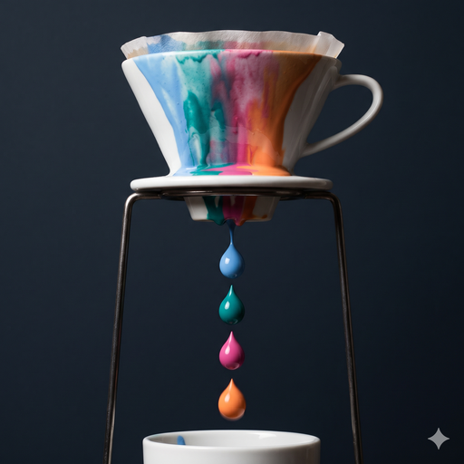

  

# daily-drip

A Discord bot that posts your daily Valorant shop to a private channel after every reset: the 4 skins with their images, VP prices and tier, and a countdown to the next reset. It pings you when a skin on your wishlist shows up.

It is read-only, and it needs neither the game nor the Riot Client running.

## Commands

| Command | What it does |
| --- | --- |
| `/shop` | Today's shop, on demand. Answered from the last fetch until the shop resets |
| `/wishlist add` | Pick a gun, then one of its current skins (both autocomplete), or "Any weapon" with part of a name: "Reaver" matches every Reaver skin |
| `/wishlist remove`, `list`, `clear` | Manage the wishlist; `list` marks entries that are in today's shop |

Both commands answer only the bot's owner.

## How it works

The bot signs in with **your Riot session cookie**, which you copy from a browser once; it never sees your password. It trades the cookie for a fresh token before each fetch, saves the cookies Riot rotates, and reads the shop from Riot's own (unofficial, undocumented) store endpoints. Skin names and images come from [valorant-api.com](https://valorant-api.com). Scheduling, retries, one-time alerts and the dead-cookie flow are described in the [spec](./Valorant%20Store%20Checker%20%E2%80%94%20Spec.md).

> [!WARNING]
> **Your Riot cookie is a full key to your account, and it gets around 2FA.** Keep it on your own machine. Never paste it into Discord, a chat, an issue or a commit. Never give it to someone else's bot, and never ask anyone for theirs. To let a friend use this, have them run their own copy.

Run it on a home machine: Riot's Cloudflare often blocks cloud and VPS IP addresses.

## Run your own

You need [Bun](https://bun.sh) 1.3.14, a Discord server of your own, and a Riot account.

1. `git clone` this repo, then `bun install`.
2. **Discord bot:** in the [Developer Portal](https://discord.com/developers/applications), create an application, then Bot → Reset Token, and turn off Public Bot. Copy `.env.example` to `.env` and fill in the four `DISCORD_` values: the token, plus the server, channel and your own user ID (Discord → Settings → Advanced → Developer Mode, then right-click → Copy ID). On its first start, the bot logs an invite link if it is not in your server yet.
3. **Riot cookie:** in a Chromium browser's private window, sign in at auth.riotgames.com. Open DevTools → Network (Preserve log on), and open the `authorize` link from the spec's Endpoints table (E1). Click that request, then Request Headers → right-click `cookie` → Copy value. Save it to `config/riot-cookie`, for example on Windows with `Get-Clipboard -Raw | Set-Content -NoNewline -Encoding ascii config\riot-cookie`. Close the window without signing out.
4. `bun start`. It posts today's shop, then the next one about 90 s after each reset.

`config/` and `data/` hold your cookie and the bot's state. Both are gitignored; keep it that way.

## Run it in Docker

To keep it running on a home server, use the included `Dockerfile` and `compose.yaml`. The container opens no ports and runs locked down (read-only, no capabilities, uid 1000).

On the server, in the folder that holds `compose.yaml`:

1. `.env` (mode 600): the four `DISCORD_` values, and `TZ` if you want local time in the logs.
2. `config/riot-cookie` (mode 600, in a `config/` folder of mode 700 owned by uid 1000): the cookie from step 3 above. Sign in again for it; do not reuse a cookie that another copy of the bot is using, because Riot rotates it on every use and one copy would lose its session.
3. `docker compose up -d --build`, then `docker compose logs -f`: expect "connected to Discord", then "shop posted".

From another machine, `DEPLOY_HOST=<ssh name> scripts/deploy.sh` copies the code over SSH, builds the image on the server and restarts the container. It never touches the server's `.env` or `config/`.

To replace the cookie later, overwrite `config/riot-cookie`; the bot notices within a minute. To change a variable, edit `.env` and run `docker compose up -d` again.

## Development

`bun test`, `bun run typecheck`. The [spec](./Valorant%20Store%20Checker%20%E2%80%94%20Spec.md) is the design document and lists what has and has not been verified.

## Credits

The auth and store flow follows [SkinPeek](https://github.com/giorgi-o/SkinPeek) (archived) and [Storefront](https://github.com/exoflex6/Storefront). Game data comes from [valorant-api.com](https://valorant-api.com).

The avatar, [`assets/avatar.png`](./assets/avatar.png), was generated with Google Gemini. Its four drops are in four of the game's skin tier colours, one per skin in the daily shop. Use it for your own copy of the bot if you like.

## Disclaimer

daily-drip isn't endorsed by Riot Games and doesn't reflect the views or opinions of Riot Games or anyone officially involved in producing or managing Riot Games properties. Riot Games, and all associated properties are trademarks or registered trademarks of Riot Games, Inc.

It uses unofficial endpoints that can change or break without notice. Riot has not said anything official about store checkers; use it at your own risk.

## License

[MIT](./LICENSE)
